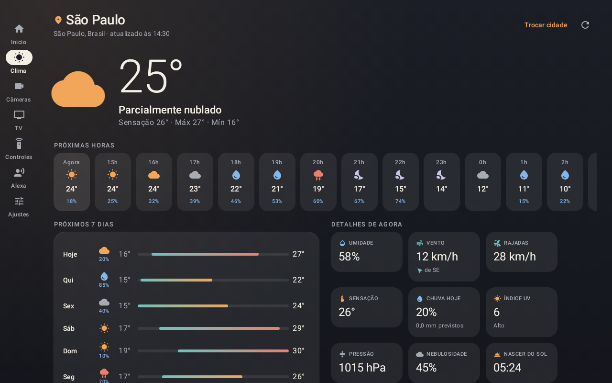

# Casa

App para **tablet Android e iPad** (funciona também em celulares e iPhone) que junta todas as marcas da casa
num painel só, no estilo do Apple Home: luzes, interruptores, tomadas, TV, câmeras,
aspirador robô, controle infravermelho, Alexa, previsão do tempo e nível dos rios.

Funciona para qualquer casa: nenhum aparelho, senha ou endereço fica fixo no código —
cada pessoa conecta o que tem em **Ajustes**.

| Tablet | Celular |
| --- | --- |
|  |  |

## O que cada aparelho usa

| Aparelho | Como o app conversa com ele | Precisa de |
| --- | --- | --- |
| Interruptores **NovaDigital**, **Intelbras Izy** e **WAG** | Nuvem Tuya (são aparelhos Tuya por dentro) | Projeto grátis em iot.tuya.com + app Smart Life |
| Controle infravermelho **Intelbras** | Nuvem Tuya (hub IR) | O mesmo projeto Tuya |
| TV **LG** Mini LED QNED 4K | Rede local (webOS), sem nuvem | IP da TV; MAC para ligá-la pelo app |
| Câmeras **EZVIZ** e **ICSee** | RTSP direto da câmera, sem nuvem | IP e senha / código de verificação |
| Aspirador **Eufy** | Home Assistant (integração Eufy RoboVac) | Home Assistant na rede |
| **Alexa** / Echo Spot | Home Assistant (integração Alexa Media Player) | Home Assistant na rede |
| Previsão do tempo | [Open-Meteo](https://open-meteo.com) (dados de serviços meteorológicos oficiais) | Só escolher a cidade |
| Nível dos rios | Painel público das Defesas Civis municipais (ex.: Rio do Sul - SC) | Cidade atendida pelo painel |

Eufy e Amazon não oferecem acesso aberto aos aparelhos para outros apps. O
[Home Assistant](https://www.home-assistant.io/) — gratuito, roda num Raspberry Pi,
mini PC ou máquina virtual — faz essa ponte dentro de casa, e o app conversa com ele.
Ele é opcional: sem ele, tudo o mais continua funcionando.

## Recursos

- **Início**: relógio, resumo da casa (luzes acesas, aparelhos ligados, aspirador, temperatura),
  cenas do Smart Life e do Home Assistant, aparelhos agrupados por cômodo. Toque liga/desliga;
  toque e segure abre os detalhes (brilho, comandos do aspirador, nome, cômodo, favorito, ocultar).
- **Voz**: botão de microfone entende português — “apagar as luzes da sala”, “ligar a cafeteira”,
  “aspirador volta pra base”, “ativar modo cinema”. O que não for da casa vai para a Alexa.
- **Clima**: temperatura, sensação térmica, condição do céu, umidade, vento com direção, rajadas,
  chance e volume de chuva, índice UV, pressão, nebulosidade, nascer e pôr do sol, as próximas
  24 horas e os próximos 7 dias. Aparece resumido na tela inicial e responde a “vai chover hoje?”.
- **Nível do rio**: leitura atual, faixa (Normal, Atenção, Alerta, Emergência), tendência em cm/h,
  gráfico das últimas 24 h e as demais estações da cidade, direto do painel da Defesa Civil.
  Aparece sozinho ao escolher no clima uma cidade atendida; também em Ajustes › Nível do rio.
- **Câmeras**: grade ao vivo (stream reduzido) e tela cheia com som (stream principal). Câmeras
  solares ou a bateria podem ficar **só de dia** ou **só quando tocar**, com desligamento
  automático (30 s a 5 min) e a última imagem vista enquanto descansam.
- **TV**: liga/desliga, direcional, voltar/início/menu, volume, canais, entradas HDMI e os apps
  instalados na TV com os ícones de verdade.
- **Controles**: botões dos controles infravermelho cadastrados no Smart Life e painel de
  ar-condicionado (temperatura, modo, ventilação).
- **Alexa**: comando por voz ou texto executado pelo Echo, anúncios, fala, “tocando agora” e volume.
- **Modo tablet de parede**: tela sempre ligada e tela cheia opcionais.

## Instalação no Android

1. Baixe o `app-release.apk` (aba **Actions** do GitHub › workflow *APK* › última execução ›
   *casa-apk*, ou gere localmente, abaixo).
2. No tablet, abra o arquivo e permita “instalar apps desconhecidos” para o navegador ou gerenciador
   de arquivos.
3. Abra **Casa › Ajustes** e conecte as integrações. Cada uma tem um “Como configurar” passo a passo.

Requer Android 8.0 ou mais novo.

## Instalação no iPhone e iPad

O app iOS é gerado num Mac do próprio GitHub: aba **Actions** › workflow *IPA (iOS)* ›
última execução › artefato *casa-ipa* (um zip com o `Casa.ipa`). Para gerar de novo, use
**Run workflow** nessa mesma tela.

Sem conta de desenvolvedor paga, a instalação é feita pelo computador:

1. Instale o [Sideloadly](https://sideloadly.io) (Windows ou Mac) ou o [AltStore](https://altstore.io).
2. Conecte o iPhone/iPad por cabo, arraste o `Casa.ipa` para o Sideloadly, entre com o seu Apple ID
   e toque em *Start*.
3. No aparelho: *Ajustes › Geral › VPN e Gerenciamento de Dispositivo* › confie no seu Apple ID.
   No iOS 16 ou mais novo, ative também *Ajustes › Privacidade e Segurança › Modo de Desenvolvedor*.
4. Na primeira abertura, permita o acesso à **rede local** — é por ela que o app fala com a TV,
   as câmeras e o Home Assistant.

Com Apple ID gratuito a instalação vale **7 dias** (o Sideloadly e o AltStore renovam). Com a conta
de desenvolvedor da Apple (US$ 99/ano) vale 1 ano e permite publicar na App Store.

Diferenças no iOS:

- **Voz**: o microfone abre um campo de comando; toque no microfone do teclado para ditar.
- **Ligar a TV pela rede**: o iOS bloqueia o sinal de Wake-on-LAN para apps sem uma permissão
  especial da Apple. Ligue pelo controle, pelo hub infravermelho ou pela Alexa; o resto do controle
  da TV funciona.
- **Câmeras**: o vídeo ao vivo usa o VLC; a última imagem das câmeras em repouso não é guardada.

Requer iOS 15 ou mais novo.

### Gerar o APK localmente

```bash
./gradlew assembleRelease          # app/build/outputs/apk/release/app-release.apk
./gradlew testDebugUnitTest        # testes + capturas das telas em app/build/outputs/roborazzi
```

Sem configuração extra o APK sai assinado com a chave de depuração. Para uma chave própria
(recomendado, para atualizar o app sem desinstalar), crie `keystore.properties` na raiz
— ele não vai para o Git:

```properties
storeFile=casa.jks
storePassword=...
keyAlias=casa
keyPassword=...
```



## Configuração

### Previsão do tempo

Em **Clima** (ou Ajustes › Clima), busque a sua cidade. Não precisa de conta nem chave.
O app usa o [Open-Meteo](https://open-meteo.com) — gratuito para uso pessoal, com dados de
institutos meteorológicos nacionais — e atualiza a cada 30 minutos com o app aberto.
A WeatherKit da Apple e a Weather API do Google exigem conta de desenvolvedor paga ou cobrança
no cartão, por isso não foram usadas.

### Smart Life / Tuya (NovaDigital, Intelbras, WAG, controle IR)

1. Crie uma conta em [iot.tuya.com](https://iot.tuya.com) › *Cloud* › *Create Cloud Project*
   (Smart Home, data center **Western America** para contas do Brasil).
2. *Devices › Link Tuya App Account*: leia o QR code com o app **Smart Life**.
   Apps de marca própria (Izy Smart, NovaDigital) normalmente não podem ser vinculados — adicione
   os mesmos aparelhos ao Smart Life.
3. *Service API*: ative **IoT Core**, **Authorization Token Management**,
   **Smart Home Scene Linkage** e **IR Control Hub Open Service**.
4. Copie *Access ID* e *Access Secret* para o app.

O plano de testes da Tuya é gratuito, mas precisa ser renovado periodicamente no mesmo site.

### TV LG

Informe o IP (e o MAC, para ligar pela rede) e toque em **Parear agora**: aceite o pedido na TV.
Para ligar a TV pelo app, ative “Ligar via Wi-Fi” nas configurações gerais da TV. Reserve um IP
fixo para ela no roteador.

### Câmeras

- **EZVIZ**: usuário `admin`, senha = código de verificação de 6 letras da etiqueta. Se não abrir,
  desative a “criptografia de imagem” no app EZVIZ.
- **ICSee/XMEye**: usuário `admin` e a senha do app ICSee (vazia se nunca definida).
- **Solares / a bateria**: em Ajustes › Câmeras, toque na câmera e escolha “Ao vivo só de dia”
  ou “Só quando tocar”. Muitos modelos a bateria dormem fora da transmissão e não aceitam RTSP;
  nesses casos o app oferece “Abrir no app iCSee”.
- **Outras**: qualquer endereço RTSP/ONVIF.

### Home Assistant (Eufy e Alexa)

1. Instale o [HACS](https://hacs.xyz) e, por ele, **Eufy RoboVac** (ou eufy-clean, conforme o
   modelo) e **Alexa Media Player**.
2. Perfil › Segurança › *Tokens de acesso de longa duração* › Criar token.
3. No app: endereço (ex.: `http://192.168.0.10:8123`) e o token.

## Privacidade

O app não tem servidor próprio, conta, anúncios nem coleta de dados. As credenciais ficam só no
aparelho — no Android cifradas com uma chave do Android Keystore, no iOS num arquivo com a proteção
de dados do sistema — e são enviadas apenas para o serviço a que
pertencem (Tuya, Home Assistant, TV, câmeras). Para a previsão do tempo, só as coordenadas da
cidade escolhida são enviadas ao Open-Meteo. Câmeras e TV são acessadas direto pela rede local.

## Estrutura

O código é um só para Android e iOS ([Kotlin Multiplatform](https://kotlinlang.org/docs/multiplatform.html)
com [Compose Multiplatform](https://www.jetbrains.com/compose-multiplatform/)):

```
shared/src/
├── commonMain/      telas, integrações e regras — 100% compartilhado
│   ├── core/        configuração, rede (Ktor), formatação, SHA-256/HMAC
│   ├── integrations/  tuya/, lg/, ha/, camera/, weather/, river/
│   ├── home/        HomeRepository (junta tudo), clima, rio, interpretador de voz
│   └── ui/          tema, componentes e telas
├── androidMain/     ExoPlayer, Android Keystore, voz do Google, Wake-on-LAN
└── iosMain/         ponte com o VLC, armazenamento protegido, entrada do app
app/                 app Android (Activity, ícone, testes e capturas de tela)
iosApp/              app iOS (SwiftUI + VLC), gerado pelo XcodeGen
```

Para incluir uma nova marca, implemente `DeviceProvider` e registre-a no `HomeRepository`.

---

© 2026 [Mauricio Renato Sarda](https://micio.dev/). Todos os direitos reservados.
