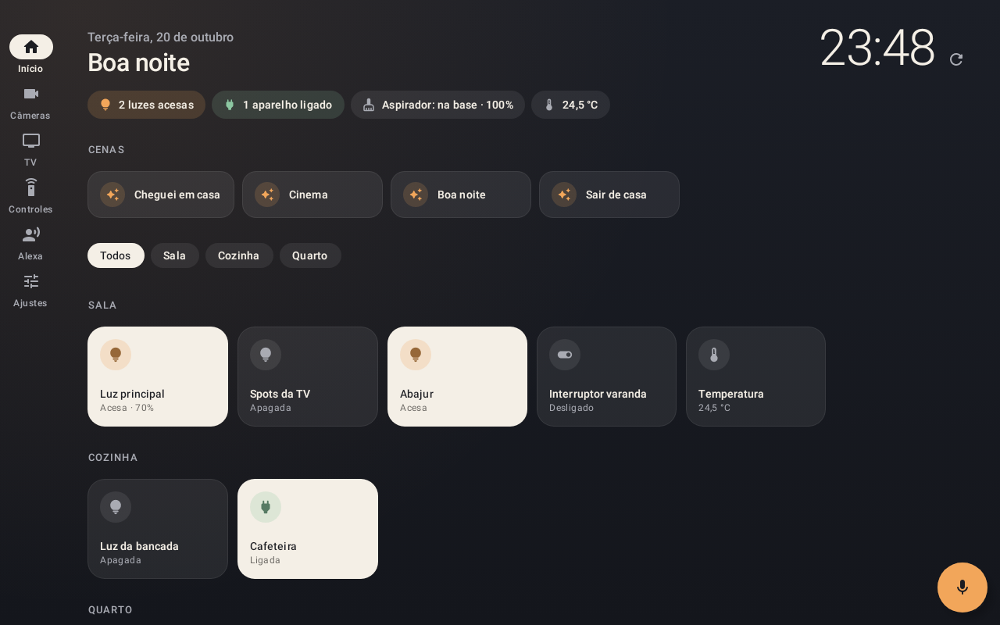
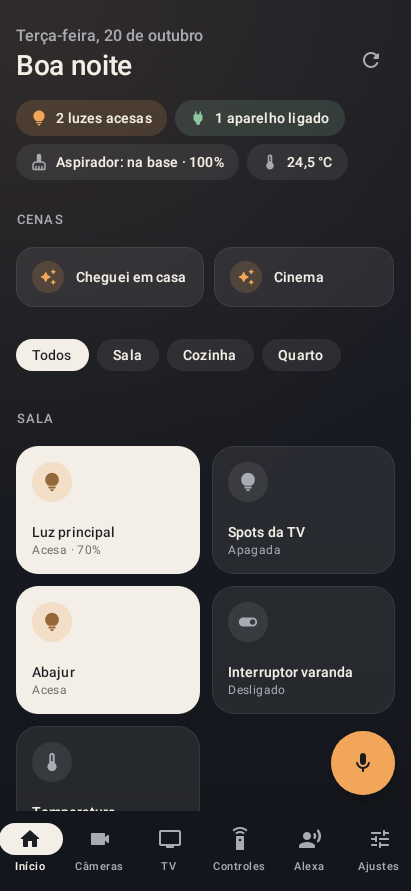

# Casa

App Android para **tablet** (funciona também no celular) que junta todas as marcas da casa
num painel só, no estilo do Apple Home: luzes, interruptores, tomadas, TV, câmeras,
aspirador robô, controle infravermelho e Alexa.

| Tablet | Celular |
| --- | --- |
|  |  |

## O que cada aparelho usa

| Aparelho | Como o app conversa com ele | Precisa de |
| --- | --- | --- |
| Interruptores **NovaDigital**, **Intelbras Izy** e **WAG** | Nuvem Tuya (são aparelhos Tuya por dentro) | Projeto grátis em iot.tuya.com + app Smart Life |
| Controle infravermelho **Intelbras** | Nuvem Tuya (hub IR) | O mesmo projeto Tuya |
| TV **LG** Mini LED QNED 4K | Rede local (webOS), sem nuvem | IP da TV; MAC para ligá-la pelo app |
| Câmeras **EZVIZ** e **ICSee** | RTSP direto da câmera, sem nuvem | IP e senha / código de verificação |
| Aspirador **Eufy** | Home Assistant (integração Eufy RoboVac) | Home Assistant na rede |
| **Alexa** / Echo Spot | Home Assistant (integração Alexa Media Player) | Home Assistant na rede |

Eufy e Amazon não oferecem acesso aberto aos aparelhos para outros apps. O
[Home Assistant](https://www.home-assistant.io/) — gratuito, roda num Raspberry Pi,
mini PC ou máquina virtual — faz essa ponte dentro de casa, e o app conversa com ele.
Ele é opcional: sem ele, tudo o mais continua funcionando.

## Recursos

- **Início**: relógio, resumo da casa (luzes acesas, aparelhos ligados, aspirador, temperatura),
  cenas do Smart Life e do Home Assistant, aparelhos agrupados por cômodo. Toque liga/desliga;
  toque e segure abre os detalhes (brilho, comandos do aspirador, nome, cômodo, favorito, ocultar).
- **Voz**: botão de microfone entende português — “apagar as luzes da sala”, “ligar a cafeteira”,
  “aspirador volta pra base”, “ativar modo cinema”. O que não for da casa vai para a Alexa.
- **Câmeras**: grade ao vivo (stream reduzido) e tela cheia com som (stream principal).
- **TV**: liga/desliga, direcional, voltar/início/menu, volume, canais, entradas HDMI e os apps
  instalados na TV com os ícones de verdade.
- **Controles**: botões dos controles infravermelho cadastrados no Smart Life e painel de
  ar-condicionado (temperatura, modo, ventilação).
- **Alexa**: comando por voz ou texto executado pelo Echo, anúncios, fala, “tocando agora” e volume.
- **Modo tablet de parede**: tela sempre ligada e tela cheia opcionais.

## Instalação

1. Baixe o `app-release.apk` (aba **Actions** do GitHub › última execução › *casa-apk*, ou gere
   localmente, abaixo).
2. No tablet, abra o arquivo e permita “instalar apps desconhecidos” para o navegador ou gerenciador
   de arquivos.
3. Abra **Casa › Ajustes** e conecte as integrações. Cada uma tem um “Como configurar” passo a passo.

Requer Android 8.0 ou mais novo.

### Gerar o APK localmente

```bash
./gradlew assembleRelease          # app/build/outputs/apk/release/app-release.apk
./gradlew testDebugUnitTest        # testes + capturas das telas em app/build/outputs/roborazzi
```

Sem configuração extra o APK sai assinado com a chave de depuração. Para uma chave própria
(recomendado, para atualizar o app sem desinstalar), crie `keystore.properties` na raiz
— ele não vai para o Git:

```properties
storeFile=casa.jks
storePassword=...
keyAlias=casa
keyPassword=...
```

## Configuração

### Smart Life / Tuya (NovaDigital, Intelbras, WAG, controle IR)

1. Crie uma conta em [iot.tuya.com](https://iot.tuya.com) › *Cloud* › *Create Cloud Project*
   (Smart Home, data center **Western America** para contas do Brasil).
2. *Devices › Link Tuya App Account*: leia o QR code com o app **Smart Life**.
   Apps de marca própria (Izy Smart, NovaDigital) normalmente não podem ser vinculados — adicione
   os mesmos aparelhos ao Smart Life.
3. *Service API*: ative **IoT Core**, **Authorization Token Management**,
   **Smart Home Scene Linkage** e **IR Control Hub Open Service**.
4. Copie *Access ID* e *Access Secret* para o app.

O plano de testes da Tuya é gratuito, mas precisa ser renovado periodicamente no mesmo site.

### TV LG

Informe o IP (e o MAC, para ligar pela rede) e toque em **Parear agora**: aceite o pedido na TV.
Para ligar a TV pelo app, ative “Ligar via Wi-Fi” nas configurações gerais da TV. Reserve um IP
fixo para ela no roteador.

### Câmeras

- **EZVIZ**: usuário `admin`, senha = código de verificação de 6 letras da etiqueta. Se não abrir,
  desative a “criptografia de imagem” no app EZVIZ.
- **ICSee/XMEye**: usuário `admin` e a senha do app ICSee (vazia se nunca definida).
- **Outras**: qualquer endereço RTSP/ONVIF.

### Home Assistant (Eufy e Alexa)

1. Instale o [HACS](https://hacs.xyz) e, por ele, **Eufy RoboVac** (ou eufy-clean, conforme o
   modelo) e **Alexa Media Player**.
2. Perfil › Segurança › *Tokens de acesso de longa duração* › Criar token.
3. No app: endereço (ex.: `http://192.168.0.10:8123`) e o token.

## Privacidade

O app não tem servidor próprio, conta, anúncios nem coleta de dados. As credenciais ficam só no
tablet, cifradas com uma chave do Android Keystore, e são enviadas apenas para o serviço a que
pertencem (Tuya, Home Assistant, TV, câmeras). Câmeras e TV são acessadas direto pela rede local.

## Estrutura

```
app/src/main/java/dev/micio/casa/
├── core/            configuração cifrada e HTTP
├── integrations/    tuya/, lg/, ha/, camera/ — cada marca traduzida para o mesmo modelo
├── home/            HomeRepository (junta tudo) e o interpretador de voz
└── ui/              tema, componentes e telas em Jetpack Compose
```

Para incluir uma nova marca, implemente `DeviceProvider` e registre-a no `HomeRepository`.

---

© 2026 [Mauricio Renato Sarda](https://micio.dev/). Todos os direitos reservados.
